# Automated Aquaculture IoT System

**Project date:** March 2023  
**Domain:** Embedded systems, sensing, feedback control, process automation  
**Prototype:** Arduino UNO R3 based Nile tilapia water monitoring and treatment system

## Project overview

This project developed and tested a small aquaculture prototype that combines water quality sensing, automatic pH adjustment, temperature regulation, water treatment, automated feeding, aeration, and a mobile monitoring interface.

The documented prototype used an Arduino UNO R3 as the controller. An HC 05 Bluetooth module linked the controller to a Flutter mobile application. The project report records physical construction and tests for water treatment, pH response, and temperature response.

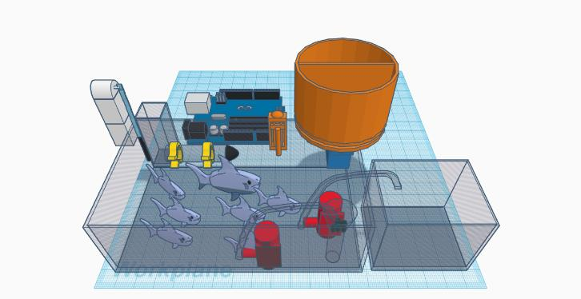

## System architecture

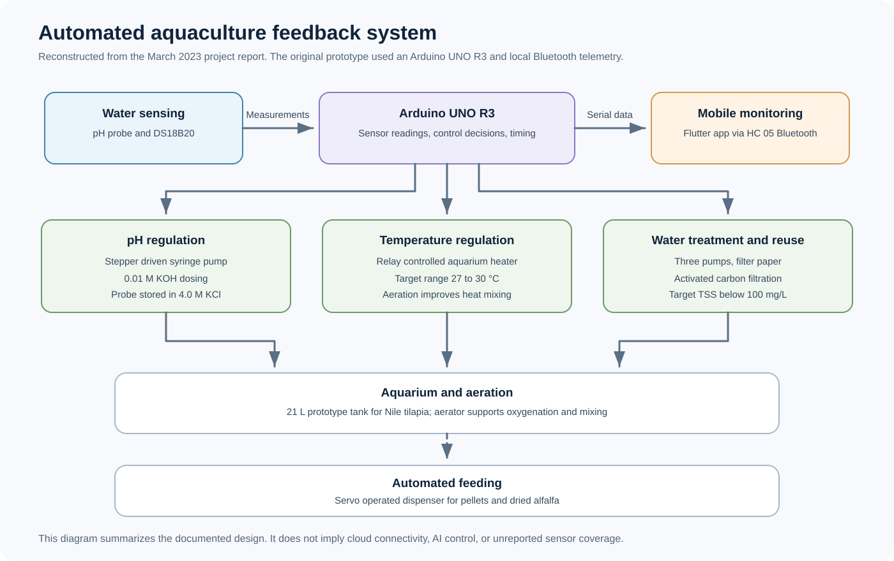

The architecture diagram is reconstructed from the original project report. It represents the described system rather than a new implementation claim.

## Verified test results

The report defines three primary design requirements and records the following test outcomes.

| Parameter | Design requirement | Reported result | Assessment in the report |
|:|:|:|:|
| Total suspended solids | Reused water below 100 mg/L | Reduced from 178 ± 1 mg/L to 65 ± 1 mg/L | Passed |
| pH | Maintain pH between 7 and 8 | Reached 7.0 ± 0.1 after 1.2 ± 0.1 minutes and remained between 7.0 and 7.5 for about 2.6 ± 0.2 minutes | Passed during the reported test |
| Temperature | Maintain 27 to 30 °C | Reached 28.0 ± 0.1 °C after 12.3 ± 0.1 minutes and remained between 28.0 and 28.4 °C for about 6.5 ± 0.2 minutes | Passed during the reported test |

The reported suspended solids removal efficiency was **63.5 ± 1.48 percent**. These are results reported by the original team, not independent replication. The tests used a small prototype and short observation windows, so they should not be interpreted as long term farm performance data.

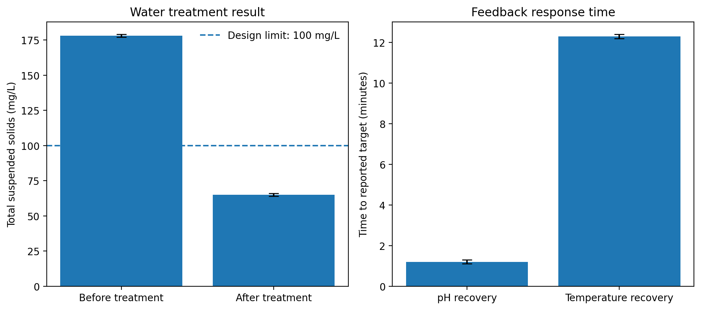

Original response graphs are also preserved from the report: [pH regulation response](assets/ph_regulation_response.png), [temperature regulation response](assets/temperature_regulation_response.png), and [temperature response without aeration](assets/temperature_without_aerator.png).

## Core subsystems

| Subsystem | Documented implementation |
|:|:|
| Controller | Arduino UNO R3 |
| pH measurement | pH probe and BNC interface module |
| pH adjustment | Stepper driven syringe pump dispensing 0.01 M potassium hydroxide solution |
| Probe storage | 4.0 M potassium chloride solution, with a robotic crane to move the probe between the tank and storage container |
| Temperature | Waterproof DS18B20 digital sensor and relay controlled aquarium heater |
| Water treatment | Filter paper and 1.00 ± 0.01 g powdered activated carbon in a funnel arrangement |
| Water transfer | Three submersible pumps with tubing |
| Aeration | Aquarium air pump used for oxygen supply and water mixing |
| Feeding | Servo operated dispenser for fish pellets and dried alfalfa |
| Monitoring | Flutter mobile application connected through HC 05 Bluetooth serial communication |
| Motor control | L293D motor driver shield documented in the materials list |

## Engineering evidence

The figures below use fixed display widths and centered image containers to keep the documentation aligned across GitHub's desktop and mobile layouts.

### Prototype design

  

### System architecture and controller wiring

<table>
  <tr>
    <td align="center" valign="top" width="50%">
      <strong>System architecture</strong>  
      
    </td>
    <td align="center" valign="top" width="50%">
      <strong>Arduino wiring diagram</strong>  
      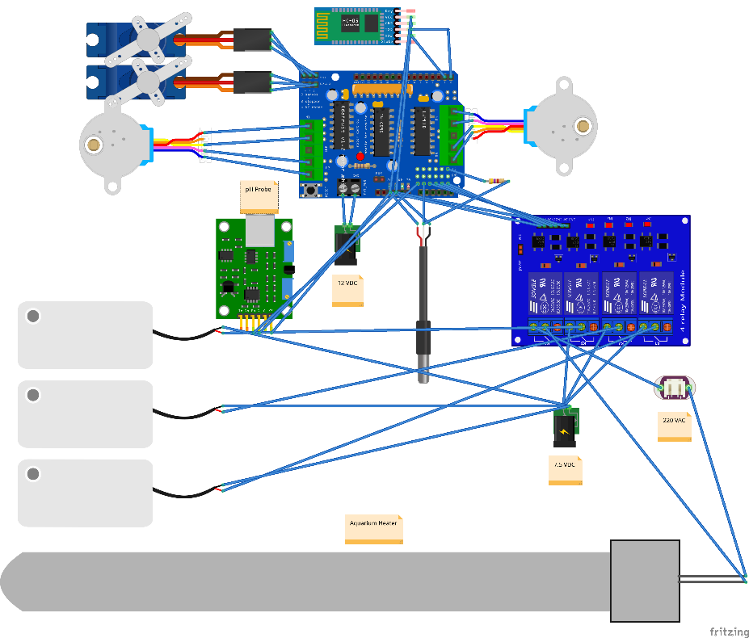
    </td>
  </tr>
</table>

### Physical prototype and mechanisms

<table>
  <tr>
    <td align="center" valign="top" width="33%">
      <strong>Water treatment</strong>  
      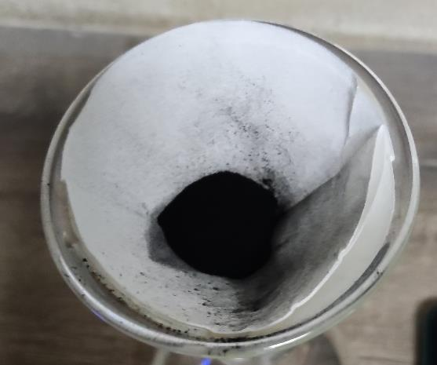
    </td>
    <td align="center" valign="top" width="33%">
      <strong>Automated feeder</strong>  
      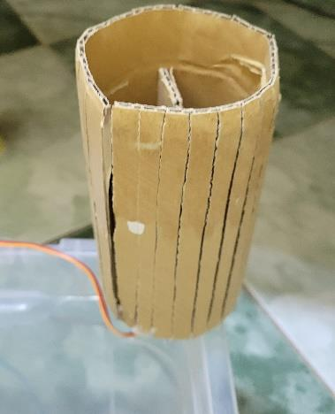
    </td>
    <td align="center" valign="top" width="33%">
      <strong>Syringe dosing</strong>  
      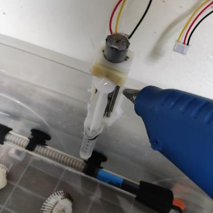
    </td>
  </tr>
  <tr>
    <td align="center" valign="top" width="50%">
      <strong>Prototype container</strong>  
      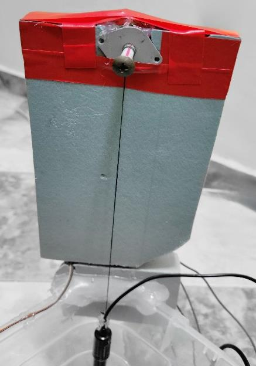
    </td>
    <td align="center" valign="top" width="50%">
      <strong>Heater arrangement</strong>  
      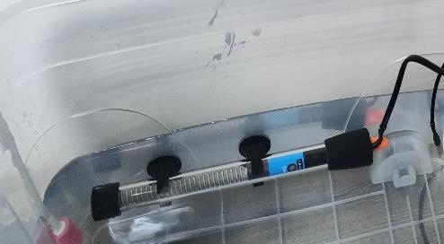
    </td>
  </tr>
</table>

### Mobile monitoring interface

<table>
  <tr>
    <td align="center" valign="top" width="50%">
      <strong>System status screen</strong>  
      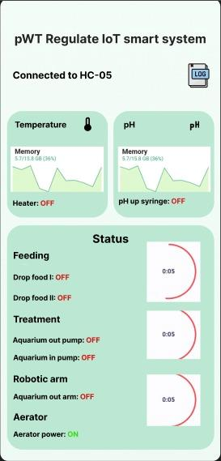
    </td>
    <td align="center" valign="top" width="50%">
      <strong>Monitoring dashboard</strong>  
      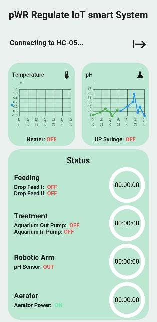
    </td>
  </tr>
</table>

### Validation plots

<table>
  <tr>
    <td align="center" valign="top" width="50%">
      <strong>pH regulation response</strong>  
      
    </td>
    <td align="center" valign="top" width="50%">
      <strong>Temperature regulation response</strong>  
      
    </td>
  </tr>
  <tr>
    <td align="center" valign="top" width="50%">
      <strong>Temperature response without aeration</strong>  
      
    </td>
    <td align="center" valign="top" width="50%">
      <strong>Reported test summary</strong>  
      
    </td>
  </tr>
</table>

The source report shows a Flutter interface and an HC 05 connection. It does not establish cloud telemetry or remote internet control.

## Design decisions and lessons

* The syringe pump stepper motor overheated when current remained applied while idle. The report notes that the motor should be released when it is not moving.
* A high speed, low torque DC motor could not reliably lift the pH probe. The mechanism was changed to a stepper motor.
* Removing the glass aquarium heater while it was operating caused thermal shock and breakage. The heater must remain submerged and be handled according to its manufacturer safety instructions.
* Sodium bicarbonate did not raise pH effectively enough in the initial trial. The team switched to potassium hydroxide solution.
* Temperature recovery took longer without aeration because heat was not distributed evenly through the water.
* The report recommends a DS3231 real time clock because the Arduino timing based on `millis()` does not preserve wall clock time after a power failure. The module was not included in the prototype due to pin limitations.
* The report recommends ion exchange resin for additional ammonia removal. That extension was not implemented in the documented prototype.

## Scope and limitations

* The prototype was designed around a 21 L class container and Nile tilapia.
* The documented feedback tests cover pH, temperature, and total suspended solids. They do not establish long term biological outcomes, disease detection, dissolved oxygen feedback control, or production yield improvement.
* The system described in the report uses local Bluetooth communication. Cloud storage, artificial intelligence, and internet based control are not documented as implemented features.
* The original report references Arduino and Flutter software, but the full source code is not included in the PDF. No firmware or app source has been reconstructed here.
* The reported sensor accuracy is reproduced from the source document and has not been independently verified.

## Repository guide

* `docs/system_architecture.md` describes system boundaries and signal paths.
* `docs/hardware.md` lists the key hardware and roles.
* `docs/control_logic.md` records the control sequence reconstructed from the report.
* `docs/validation.md` summarizes the design requirements and measured outcomes.
* `docs/lessons_learned.md` records documented failures and corrective actions.
* `docs/safety.md` captures the electrical, liquid, chemical, and heater precautions relevant to the prototype.
* `docs/references.md` lists the original report and selected cited research.
* `data/validation_results.csv` contains the numerical results reported in the document.
* `firmware/README.md` and `mobile_app/README.md` clarify the limits of the available source material.
* `assets/` contains selected figures and photographs extracted from the original report, plus a reconstructed system diagram and summary chart.

## Primary source

The technical details and test values in this repository are derived from the original March 2023 project report, *Advanced IoT Integrated Automated Aquacultural System with Real Time Feedback for Optimal Productivity and Sustainability*. See [the source report](https://drive.google.com/file/d/1sk-0LAVp32ne3fXqk1-1biSkbSBtEg8Y/view).

This repository is a structured technical record of the documented prototype. It does not claim that absent source code, cloud services, or additional experiments were implemented.
