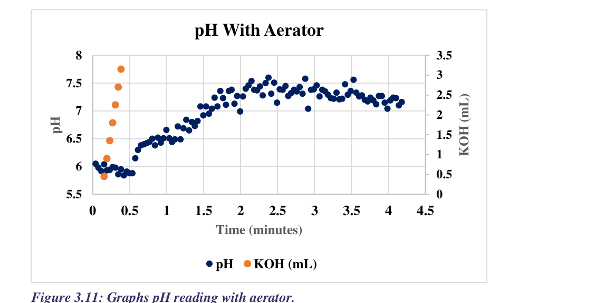
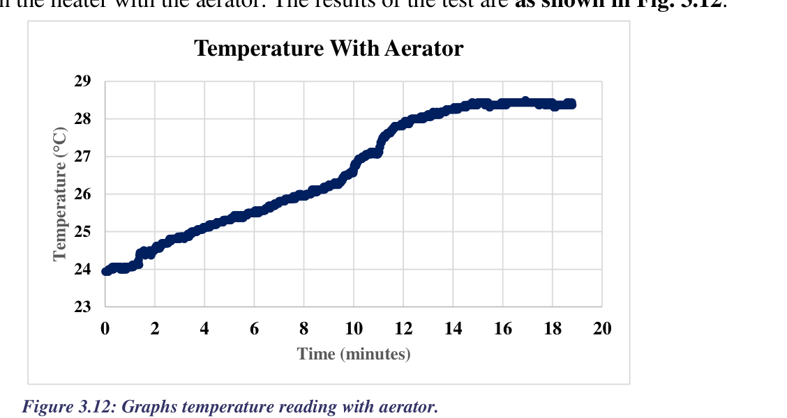
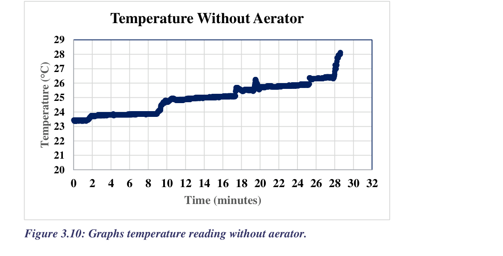

# Validation record

## Requirements and reported outcomes

| Test | Requirement | Method described in the report | Reported outcome |
|:|:|:|:|
| Water treatment | TSS below 100 mg/L in reused water | A sample from a Nile tilapia tank unchanged for six days was filtered through filter paper with 1.00 ± 0.01 g powdered activated carbon | TSS decreased from 178 ± 1 mg/L to 65 ± 1 mg/L, with removal efficiency 63.5 ± 1.48 percent |
| pH feedback | Maintain pH between 7 and 8 without manual intervention | Water pH was reduced to 6.0 ± 0.2 using lemon juice, then the syringe pump dosed 3.15 ± 0.05 mL of 0.01 M KOH with aeration operating | pH reached 7.0 ± 0.1 after 1.2 ± 0.1 minutes and stayed between 7.0 and 7.5 for 2.6 ± 0.2 minutes |
| Temperature feedback | Maintain temperature between 27 and 30 °C without manual intervention | Water was cooled to 23.9 ± 0.5 °C with cold water, then the heater operated with aeration | Temperature reached 28.0 ± 0.1 °C after 12.3 ± 0.1 minutes and stayed between 28.0 and 28.4 °C for 6.5 ± 0.2 minutes |

## Interpretation

The original report concludes that the prototype passed its three design requirements in the recorded tests. The results demonstrate short test responses in a small prototype. They do not establish continuous operation over weeks, fish growth performance, ammonia removal, disease detection, or commercial scale performance.

## Test limitations

* The report does not include the raw time series files used to draw the response graphs.
* The report does not describe repeated trials or confidence intervals derived from a documented statistical model.
* The temperature and pH observations cover short windows after disturbance.
* The TSS result is for the described filtration sample, not a long term field trial.

## Original figures

